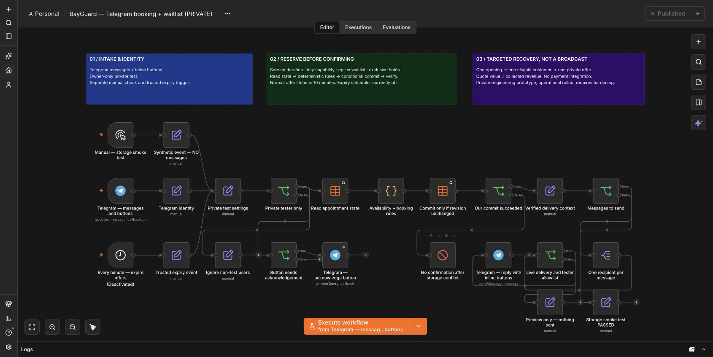

# BayGuard — повернення скасованих записів

Незалежний інженерний прототип на **n8n + Telegram** для сценарію детейлінг-студії в Дубаї. Не клієнтський проєкт і не звіт про отриманий дохід.

Клієнт обирає послугу й доступний час. Якщо запис скасовано, система перевіряє тривалість послуги, можливості поста й згоду учасників листа очікування. Перше сумісне звернення отримує персональну пропозицію з тимчасовим утриманням вікна. Не масова розсилка: одне вікно — один кандидат — одна пропозиція.

Стандартний строк пропозиції — 10 хвилин. Відмова або прострочення дозволяє перейти до наступного сумісного кандидата. Бронювання підтверджується лише після умовного запису стану та перевірки revision/commit token.

- **74 локальні синтетичні перевірки**: 41 ядра, 33 адаптера.
- Живий приватний тест: запис, скасування, лист очікування, прийняття пропозиції.
- Прискорений тест: автоматичне прострочення через 1 хвилину та відмова застарілій кнопці.
- Нативні Telegram і Data table ноди; одна Code-нода для бізнес-правил. LLM не використовується.

Запуск перевірок: Node.js 22+, `npm test`; сторонні залежності й API-ключі не потрібні.

## Матеріали

- [Основний README англійською](README.md)
- [Налаштування та імпорт JSON](docs/setup.md)
- [Що робить кожна нода](docs/nodes.md)
- [Межі тестування й готовності](docs/validation.md)
- [Бізнес-модель та припущення](docs/business-model.uk.md)

Експорти очищені від credentials, реальних Telegram ID, адреси сервера та живих записів. Відправлення вимкнене; таймер вимкнений; ID тестувальника — `0`. Потрібно самостійно підключити окрему таблицю та тестового бота. Не імпортуйте seed поверх робочих даних.

Для продакшену ще потрібні перевірка конкурентних запитів, надійне відновлення доставки, контроль зберігання персональних даних, моніторинг і резервне копіювання. Вартість бронювання не є оплатою; сценарні розрахунки не є доведеним прибутком.
